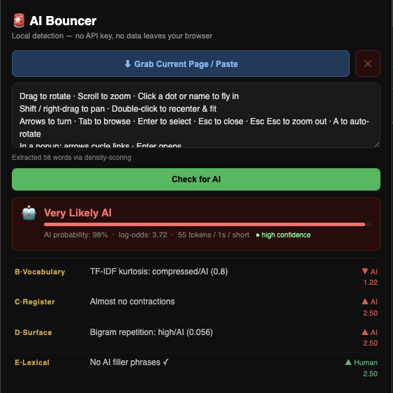

# AI Bouncer

> Local AI-generated text detection for your browser.  
> No API key. No data leaves your machine. No server calls.

[](LICENSE)


---

## What it does

AI Bouncer analyses any web page or pasted text and estimates the probability
that it was written by an AI language model. Click the extension icon — the
current page is analysed immediately, no button presses needed.



*The popup after analysing a page: an "AI Bouncer" title with the tagline "Local detection — no API key, no data leaves your browser", then a dark interface with a blue "Grab Current Page / Paste" button above an editable text box holding the extracted text, with a note that 58 words were extracted via density-scoring. Below the green "Check for AI" button, a red result card reads **Very Likely AI** with a probability bar at 98%, log-odds of 3.72, and a "high confidence" tag. The signal breakdown underneath lists each contributing group with a plain-language reason, a direction arrow (red for AI, green for Human) and its score: B·Vocabulary (TF-IDF kurtosis), C·Register (almost no contractions), D·Surface (bigram repetition) and E·Lexical (no AI filler phrases).*

The result includes:
- A probability score (0–100%) with a plain-language verdict
- A confidence level (high / medium / low)
- A breakdown of which signals drove the score, each explained
- A genre flag when the text belongs to a formal or conversational category
  that makes heuristic detection less reliable

Everything runs in your browser. No text is transmitted anywhere.

---

## Installation

### Chrome / Chromium

1. Download `ai-bouncer-chrome.zip` from [Releases](../../releases)
2. Unzip it
3. Go to `chrome://extensions`
4. Enable **Developer mode** (top right toggle)
5. Click **Load unpacked** and select the unzipped folder

### Firefox

The Firefox build uses `manifest.firefox.json` in place of `manifest.json`
(copy it over `manifest.json` when building from source).

1. Download `ai-bouncer-firefox.xpi` from [Releases](../../releases)
2. Go to `about:addons`
3. Click the gear icon → **Install Add-on From File**
4. Select the `.xpi` file

> **Note:** The `.xpi` in Releases is unsigned. Permanent installation
> requires Firefox Developer Edition or Nightly with
> `xpinstall.signatures.required` set to `false` in `about:config`.
> For temporary use, load via `about:debugging` → This Firefox →
> Load Temporary Add-on.

---

## How it works

### Core principle

Rather than matching surface patterns (word lists alone), the engine measures
the *statistical shape* of text — distributions, variance, entropy. The
insight: AI-generated and human-written text have measurably different
distributional fingerprints at every level. No single signal is reliable;
the composite of six independent signal groups is.

### Length stratification

Text is classified into one of three strata before analysis. Calibration
constants and active signals differ per stratum because the same feature
can have different behaviour — even opposite direction — at different lengths.

| Stratum | Word count | Notes |
|---------|-----------|-------|
| Short   | < 200w     | Fewer signals active; lower confidence |
| Medium  | 200–800w   | Full signal set; most reliable stratum |
| Long    | > 800w     | Some signals reverse direction; separate calibration |

### Signal groups

Six independent groups each contribute a **log-likelihood ratio (LLR)** to
a shared accumulator. The sigmoid of the total gives the AI probability score.

Within each group, only the single strongest signal contributes — preventing
double-counting of correlated features.

| Group | Name       | What it measures |
|-------|------------|-----------------|
| A | Rhythm     | Sentence length CV; punctuation interval CV |
| B | Vocabulary | TTR curve SD; TF-IDF kurtosis; word positional dispersion |
| C | Register   | Contraction rate; first-person rate; slang and informal markers |
| D | Surface    | Character trigram entropy; bigram repetition |
| E | Lexical    | Filler phrase density; sentence-opener entropy; synonym register ratio |
| F | Genre      | Competing formal vs conversational weighted score classifier |

### Gaussian likelihood ratios

Each continuous feature is modelled as two Gaussians — one fitted to
AI-generated text, one to human-written text:

```
LLR = log( P(observed | AI text) / P(observed | Human text) )
```

- **Positive LLR** → AI evidence
- **Negative LLR** → Human evidence
- **Near zero** → Inconclusive for this feature

Each LLR is clamped to `[−2.5, +2.5]` to prevent any single signal from
dominating the composite score.

### Genre classifier (Group F)

Formal writing (academic papers, technical reports) and conversational writing
(chat messages, code review comments) share surface properties with AI output
for structural reasons unrelated to AI generation. Group F runs two competing
weighted-score classifiers — formal markers vs conversational markers — both
rate-normalised per 100 words. Rate normalisation is the key mechanism: a
single "Thanks" in a 14,000-word paper produces a near-zero conversational
rate that cannot compete with dense citation markers. The dominant genre wins
and contributes a small LLR to the accumulator, while also capping confidence.

### Verdict bands

| Score    | Verdict            |
|----------|--------------------|
| ≥ 80%    | Very Likely AI     |
| 62–79%   | Possibly AI        |
| 39–61%   | Inconclusive       |
| 21–38%   | Likely Human       |
| ≤ 20%    | Very Likely Human  |

Bands are intentionally wide. The engine reports uncertainty rather than
forcing a verdict when evidence is weak.

### Confidence levels

| Level  | Meaning |
|--------|---------|
| High   | \|log-odds\| > 3.5, ≥ 2 active groups |
| Medium | \|log-odds\| > 1.5, ≥ 2 active groups (or capped from High by formal genre) |
| Low    | Weak signal, < 2 active groups, or capped by conversational/mixed genre |

---

## Calibration

All Gaussian parameters (μ, σ) and genre marker weights are documented inline
in `popup.js` for every signal and every stratum. They were derived empirically
from sample texts.

To retune: measure feature values on labelled AI/human samples and update the
`cal[]` arrays in the relevant signal group function. The current calibration
targets GPT-3.5/4-era output.

---

## Known limitations

- **Paraphrasing** reduces accuracy — an AI text that has been paraphrased to
  vary sentence structure and replace filler phrases will score lower.
- **Formal writing** (academic papers, legal documents, medical reports)
  shares surface properties with AI output. Group F partially mitigates this.
- **News articles** score high-AI due to impersonal register — a known
  false-positive genre not yet covered by Group F.
- **Short texts** (< 200w) have fewer active signals; confidence is lower.
- **Calibrated against GPT-3.5/4** — may need retuning for future models.

---

## Project structure

```
ai-bouncer/
├── manifest.json           # Chrome MV3 manifest
├── manifest.firefox.json   # Firefox MV3 manifest
├── popup.html              # Extension popup UI and styles
├── popup.js                # Detection engine + UI logic (fully documented)
├── content.js              # Page text extraction (injected into active tab)
├── icon.png                # Extension icon
├── LICENSE                 # PolyForm Noncommercial License 1.0.0
├── README.md               # This file
└── CONTRIBUTING.md         # Contribution guidelines and CLA
```

---

## Attribution

If you use, reference, or build upon AI Bouncer, you must include the
following attribution in a clearly visible location:

```
Powered by AI Bouncer — https://github.com/krstp/ai-bouncer
Copyright (c) 2026-present Krystian Paczkowski and AI Bouncer Contributors
```

See the [LICENSE](LICENSE) for full attribution requirements.

---

## Licensing

AI Bouncer is licensed under the
[PolyForm Noncommercial License 1.0.0](LICENSE).

- **Non-commercial use** — free, with attribution
- **Commercial use** — requires a separate paid licence

To discuss commercial licensing, open an issue or contact the maintainers
directly via the repository.

---

## Contributors

- [Krystian Paczkowski](https://github.com/krstp) — author and maintainer

---

## Contributing

See [CONTRIBUTING.md](CONTRIBUTING.md).

---

## Acknowledgements

Detection methodology draws on peer-reviewed research in AI-generated text
detection:

- Xiang et al., "AI-Generated Text Detection: A Comprehensive Review of
  Active and Passive Approaches", *Computers, Materials and Continua*,
  Vol. 86, 2026.
- Mitchell et al., "DetectGPT: Zero-Shot Machine-Generated Text Detection
  Using Probability Curvature", ICML 2023.
- Gehrmann et al., "GLTR: Statistical Detection and Visualization of
  Generated Text", ACL 2019.
